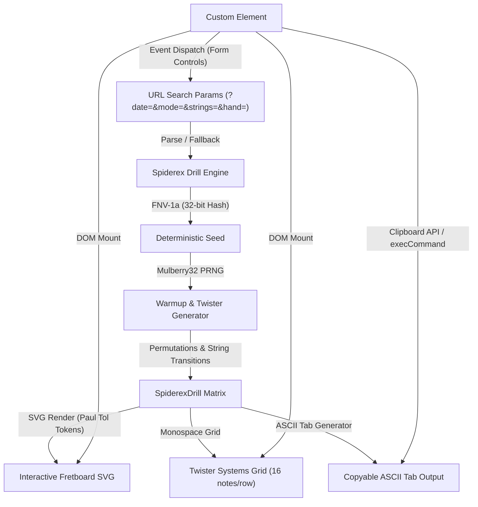
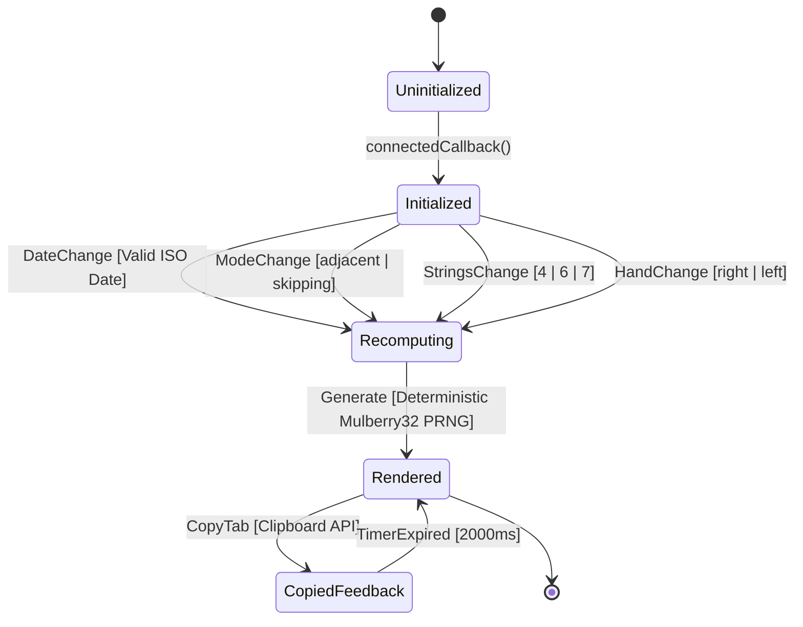

# Concept Canvas: Works Spiderex Interactive Trainer

## 1. Problem Space & Domain Intent
- **What Human / System Need Does This Fulfill?**: Provides guitarists and fretted instrument players with a zero-friction, deterministic spider-exercise routine generator and visual interactive fretboard trainer on `/works/spiderex/`. It supports 4-finger permutations across 4, 6, and 7-string layouts, offering daily seeded drills, custom parameter manipulation, instant ASCII tab copying, and high-contrast color-blind safe visualization.
- **Anti-Goals (What This Explicitly Does NOT Do)**:
  - Does NOT embed audio synthesis or soundfont playback engines (zero web audio bloat, keeping zero-JS/low-JS budget intact).
  - Does NOT persist user state to cloud databases or remote servers (pure client-side URL search param serialization with full privacy).
  - Does NOT introduce client-side runtime layout shifts (strict 0.0000 CLS with fixed-geometry SVG and monospace typography).
  - Does NOT introduce external client frameworks (vanilla TypeScript Custom Element `<spiderex-trainer>` without React/Vue/Svelte runtime overhead).

## 2. Architectural Parti
- **Governing Metaphor**: "Deterministic Permutation Crucible" — every daily challenge and custom exercise permutation is distilled from a pure seed via mathematical hashing into an immutable, repeatable fretboard routine.
- **Core Invariant**: "0-CLS immutable fretboard geometry and pure FNV-1a/Mulberry32 PRNG seed" — identical input parameters always yield identical drill matrices across all viewports and sessions without layout recomputation.
- **Guiding Tension**: "Generative variability vs. zero-layout shift accessibility" — balancing rich mathematical exercise permutation against strict static page budgets, Paul Tol color tokens, and WCAG 2.2 AA contrast compliance.

## 3. Conceptual Mural (Domain Topology)

## 4. Semantic Vocabulary (Glossary of Nouns & Verbs)
| Domain Term | Semantic Definition | Prohibited Synonyms / Anti-Concepts |
| :--- | :--- | :--- |
| **Spiderex** | The deterministic spider-exercise guitar coordination system mounted on `/works/spiderex/`. | Not a generic "game" or "metronome". |
| **Warmup** | The baseline 4-bucket permutation exercise across all instrument strings. | Avoid "Intro" or "Level 1". |
| **Twister** | The 16-bar randomized string-skipping coordination challenge generated via seeded PRNG. | Avoid "Random mode" or "Boss fight". |
| **Permutation Bucket** | One of 4 partitions of the 24 canonical 4-finger permutations grouped by starting finger (1..4). | Not "random array" or "shuffle list". |
| **Mulberry32** | Pure, deterministic 32-bit PRNG accepting an unsigned 32-bit integer seed. | Not `Math.random()`. |
| **FNV-1a** | 32-bit non-cryptographic Fowler-Noll-Vo hash algorithm for string seed digest. | Not MD5 or SHA-256. |
| **String Mode** | Transition rule: `adjacent` (stepwise string traversal) or `skipping` (non-adjacent leaps). | Not "difficulty" or "easy/hard". |
| **Hand Orientation** | Physical fretboard rendering perspective (`right` for right-handed, `left` for left-handed). | Not "mirror mode". |
| **Copy Tab** | Action formatting ASCII tab with explicit string tuning indicators, headers, and bar lines. | Not "Export song" or "Print sheet music". |

## 5. Entity-State Lifecycle Matrix (Trainer State Transitions)
| Current State | Permitted Action / Verb | Target State | Guard / Invariant Condition | Failure / Rejection Result |
| :--- | :--- | :--- | :--- | :--- |
| `Uninitialized` | `connectedCallback()` | `Initialized` | `<spiderex-trainer>` element attached to DOM with query selectors resolved | Fallback to server-rendered static HTML drill markup |
| `Initialized` | `DateChange` | `Recomputing` | Target date parses as valid ISO YYYY-MM-DD calendar date | Revert input to current active date without dispatch |
| `Initialized` | `ModeChange` | `Recomputing` | Mode is either `'adjacent'` or `'skipping'` | Retain prior mode selection |
| `Initialized` | `StringsChange` | `Recomputing` | Strings count is 4, 6, or 7 | Retain prior string count |
| `Initialized` | `HandChange` | `Recomputing` | Hand orientation is `'right'` or `'left'` | Retain prior hand orientation |
| `Recomputing` | `Generate` | `Rendered` | Mulberry32 PRNG run with deterministic seed, producing 16 valid bars | Graceful error boundary; UI retains prior drill |
| `Rendered` | `CopyTab` | `CopiedFeedback` | Valid ASCII tab rendered; `navigator.clipboard.writeText` or `execCommand` called | Fallback to manual selection / toast error message |
| `CopiedFeedback` | `TimerExpired` | `Rendered` | Feedback timeout (2000ms) elapses | Reset copy button label and aria-live status |

### Mermaid State Diagram Companion

## 6. Physical Data Architecture (DA) Contract
- **Persistence Mechanism**: Client-side URL query parameters (`?date=YYYY-MM-DD&mode=[adjacent|skipping]&strings=[4|6|7]&hand=[right|left]`). No local storage, cookies, or remote session state required.
- **Wire & Property Casing**: URL query parameters and HTML element data attributes strictly `snake_case` / `kebab-case`; TypeScript domain interfaces strictly `camelCase` with explicit type guards.
- **Concurrency & Locking**: Single-threaded browser event loop inside custom element island. State modifications synchronous via `replaceState` or reactive re-render.
- **Rollback Strategy**: If user parameters are invalid or corrupted, engine safely reverts to current system date (`new Date().toISOString().slice(0, 10)`), 6 strings, adjacent mode, right-handed defaults.

## 7. Verification Runbook
1. **Type Safety & AST Parsing**: Run `npm run check` and ensure 0 TypeScript or Astro compiler errors.
2. **Deterministic PRNG & Output Tests**: Run `npm test` to verify all Mulberry32, FNV-1a, permutation, and tab formatting unit tests pass.
3. **Budget & Zero-JS Integrity**: Run `pwsh ./scripts/ci-local.ps1` to verify `/works/spiderex/` satisfies `workIsland` budget ($\le 26,664$ bytes) and client JS gzip budget ($\le 5,923$ bytes).
4. **Accessibility Audit**: Playwright and axe run through `ci-local.ps1` asserting 0 WCAG 2.2 AA violations on `/works/spiderex/`.
